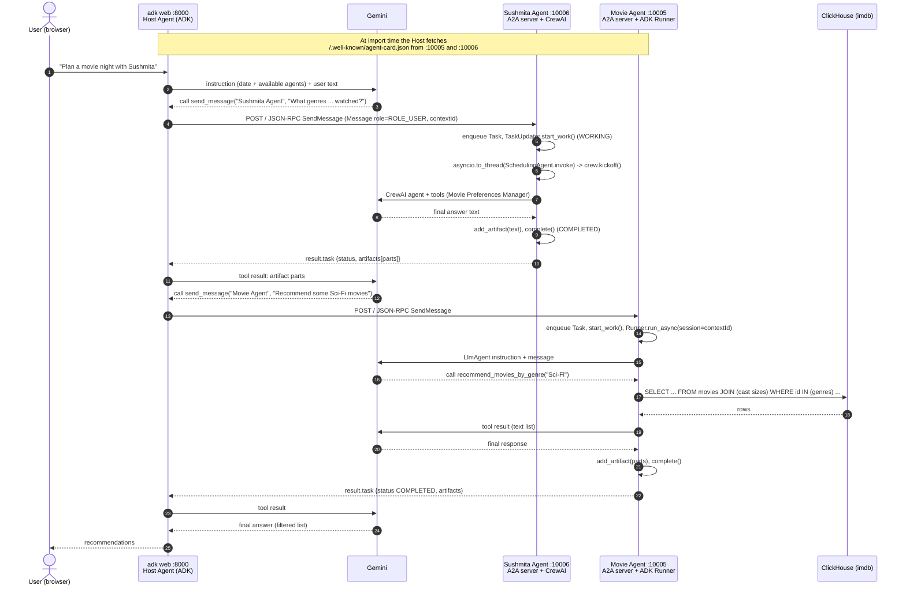

# Architecture

This document describes the three agents, how they are wired together, and what happens, step by step, when you type a message into the web UI.

- [Components](#components)
- [Ports and endpoints](#ports-and-endpoints)
- [Startup order and discovery](#startup-order-and-discovery)
- [End-to-end request flow](#end-to-end-request-flow)
- [Sequence diagram](#sequence-diagram)
- [State and sessions](#state-and-sessions)
- [Error handling](#error-handling)
- [Design notes and known limitations](#design-notes-and-known-limitations)

---

## Components

| Component | Code | Framework | Runs as | Role |
|-----------|------|-----------|---------|------|
| **Host Agent** | `Solution/host_agent/host/agent.py` | Google ADK `Agent` (`google-adk` 2.12) | `adk web` web UI on port 8000 | Talks to the user, decides which remote agent to ask, filters results, saves movie plans |
| **Movie Agent** | `Solution/movie_agent/` | Google ADK `LlmAgent` + 6 Python tools | A2A server (Starlette + uvicorn) on `localhost:10005` | Answers movie questions with SQL queries against the IMDB dataset in ClickHouse |
| **Sushmita Agent** | `Solution/sushmita_agent/` | CrewAI `Agent` / `Task` / `Crew` (`crewai` 1.15) | A2A server (Starlette + uvicorn) on `localhost:10006` | Knows Sushmita's (randomly generated) availability, favourite genres and already-watched movies |
| **ClickHouse** | `clickhouse/` (schema + loader only) | ClickHouse server | Public SQL playground by default (`sql-clickhouse.clickhouse.com:443`), or your own service | Stores the `imdb` database (6 tables) |
| **Gemini** | (external) | `google-genai` via ADK, LiteLLM-style `gemini/...` via CrewAI | Google API | The LLM behind all three agents (default `gemini-3.8-flash`) |

Every agent process is independent: the two remote agents know nothing about the Host Agent or about each other. The only coupling is the A2A protocol (HTTP + JSON-RPC) and the agent cards.

```
            you (browser, http://localhost:8000)
                          │  HTTP (adk web UI / API)
                    ┌─────▼──────┐
                    │ Host Agent │  ADK Agent, tools: send_message,
                    │  (adk web) │  confirm/get/cancel_movie_plan
                    └──┬──────┬──┘
     A2A JSON-RPC      │      │     A2A JSON-RPC
     SendMessage       │      │     SendMessage
          ┌────────────▼┐    ┌▼───────────────┐
          │ Movie Agent │    │ Sushmita Agent │
          │   :10005    │    │    :10006      │
          │ ADK Runner  │    │  CrewAI Crew   │
          └──────┬──────┘    └────────────────┘
                 │ HTTPS (clickhouse-connect), parameterised SQL
          ┌──────▼──────┐
          │ ClickHouse  │  database imdb
          └─────────────┘
```

### Inside each remote agent server

Both remote agents use the same a2a-sdk 1.x server stack, built in their `__main__.py`:

```
uvicorn
 └─ Starlette(routes=...)
     ├─ create_agent_card_routes(agent_card)          GET  /.well-known/agent-card.json
     └─ create_jsonrpc_routes(request_handler, "/")   POST /   (JSON-RPC 2.0)
          └─ DefaultRequestHandler(agent_executor, InMemoryTaskStore(), agent_card)
               └─ AgentExecutor.execute(context, event_queue)
                    ├─ Movie Agent:    MovieAgentExecutor   -> ADK Runner -> LlmAgent -> tools -> ClickHouse
                    └─ Sushmita Agent: SchedulingAgentExecutor -> SchedulingAgent.invoke() -> CrewAI Crew
```

The `AgentExecutor` is the bridge between the protocol and the framework: it receives a `RequestContext` (the incoming message, task id, context id) and publishes events (`Task`, status updates, artifacts) on an `EventQueue` through a `TaskUpdater`. The request handler turns those events into the JSON-RPC response.

---

## Ports and endpoints

| Port | Process | Endpoint | Purpose |
|------|---------|----------|---------|
| 8000 | `adk web --port 8000` (from `Solution/host_agent`) | `http://localhost:8000` | ADK dev web UI; pick the **host** app |
| 10005 | `python .` in `Solution/movie_agent` | `GET http://localhost:10005/.well-known/agent-card.json` | Movie Agent card |
| 10005 | same | `POST http://localhost:10005/` | JSON-RPC (`SendMessage`, `GetTask`, ...) |
| 10006 | `python .` in `Solution/sushmita_agent` | `GET http://localhost:10006/.well-known/agent-card.json` | Sushmita Agent card |
| 10006 | same | `POST http://localhost:10006/` | JSON-RPC |
| 443 | ClickHouse SQL playground | `https://sql-clickhouse.clickhouse.com` | Default database (user `demo`, no password, database `imdb`) |

Host and port of the remote agents are hard-coded (`host = "localhost"`, `port = 10005` / `10006` in each `__main__.py`), and so are the URLs the Host Agent contacts (`friend_agent_urls` in `_get_initialized_host_agent_sync()`). The only override is `HOST_OVERRIDE`, which changes the URL the Sushmita Agent **advertises** in its card (see [CONFIGURATION.md](CONFIGURATION.md)).

---

## Startup order and discovery

1. **Movie Agent** (`Solution/movie_agent/__main__.py`, `main()`):
   - `load_dotenv()` finds the repo-root `.env` by walking up from the script's folder.
   - Fails fast (`MissingAPIKeyError`, exit 1) if `GOOGLE_API_KEY` is missing and `GOOGLE_GENAI_USE_VERTEXAI` is not `TRUE`.
   - Builds the `AgentCard` (one skill, `movie_recommendations`, `capabilities.streaming=True`), the ADK `LlmAgent` via `create_agent()`, a `Runner` with in-memory session/artifact/memory services, the `MovieAgentExecutor`, and the Starlette app.
   - Importing `agent.py` prints the ClickHouse host it will use. No ClickHouse connection is opened at startup: each tool call opens its own.
2. **Sushmita Agent** (`Solution/sushmita_agent/__main__.py`, `main()`):
   - Requires `GOOGLE_API_KEY` (no Vertex AI path).
   - Importing `agent.py` runs `generate_calendar()` once and prints the random calendar.
   - Builds the card (two skills, `availability_checker` and `movie_preferences`, `capabilities.streaming=False`) and `SchedulingAgentExecutor`, which constructs the CrewAI agent.
3. **Host Agent** (`adk web`, started last):
   - `adk web` scans its working directory (`Solution/host_agent`) for agent packages. `host/__init__.py` does `from .agent import root_agent`, so the **host** app appears in the dropdown.
   - Importing `host/agent.py` runs `root_agent = _get_initialized_host_agent_sync()`. That calls `asyncio.run(...)` (made re-entrant by `nest_asyncio.apply()`) which runs `HostAgent.create()`:
     - for each URL in `friend_agent_urls`, `A2ACardResolver(client, address).get_agent_card()` fetches `/.well-known/agent-card.json`;
     - each card gets a `RemoteAgentConnections` (an a2a-sdk client built by `ClientFactory`), stored in a dict keyed by **`card.name`** (`"Movie Agent"`, `"Sushmita Agent"`);
     - the names and descriptions are serialised into `self.agents`, which the dynamic instruction injects into the prompt.
   - A card that cannot be fetched is logged (`ERROR: Failed to get agent card from ...`) and skipped. That is why the remote agents must be running **before** `adk web` starts: cards are only fetched once, at import time.

---

## End-to-end request flow

Example: *"Plan a movie night with Sushmita: pick a film she hasn't seen in a genre she likes."*

1. **Browser → adk web.** The ADK web UI sends the message to the `adk web` API server, which runs `root_agent` (the Host Agent) in an ADK session for the browser conversation.
2. **Host LLM decides.** ADK calls Gemini with the Host's instruction. The instruction is a *callable* (`HostAgent.root_instruction(context)`), so it is rebuilt on every turn and contains today's date and the `<Available Agents>` list. Following its workflow, the model emits a function call:
   `send_message(agent_name="Sushmita Agent", task="What genres of movies do you like and what movies have you already watched?")`.
3. **`send_message` tool** (`HostAgent.send_message`):
   - looks up `self.remote_agent_connections[agent_name]` (raises `ValueError` for an unknown name);
   - builds a protobuf `Message(role=Role.ROLE_USER, parts=[Part(text=task)], message_id=<uuid4>, context_id=<...>)`, reusing the `context_id` stored for that agent in the tool-context state (a new `uuid4()` on the first call) and adding a `task_id` only if that agent's last task is waiting for input;
   - wraps it in `SendMessageRequest(message=...)` and calls `RemoteAgentConnections.send_message()`.
4. **A2A client → JSON-RPC.** The client created by `ClientFactory(ClientConfig(streaming=False, ...)).create(card)` uses the card's `supported_interfaces` entry (`JSONRPC`, `http://localhost:10006/`) and POSTs a JSON-RPC 2.0 request with `"method": "SendMessage"` and an `A2A-Version: 1.0` header. Because streaming is disabled, the call blocks until the task finishes; `send_message()` iterates the response stream and keeps the last item.
5. **Server side.** `DefaultRequestHandler` sees no `task_id` on the message, so it creates a new task id in the message's `context_id` (the same conversation as earlier calls to that agent). It builds a `RequestContext` and calls the executor's `execute()`.
6. **AgentExecutor.** Both executors:
   - enqueue a new `Task` built from the user message (`new_task_from_user_message`) if `context.current_task` is empty (a2a-sdk 1.x requires the task event first);
   - create a `TaskUpdater` and call `start_work()` (state `TASK_STATE_WORKING`);
   - run the framework:
     - **Sushmita:** `await asyncio.to_thread(self.agent.invoke, query)`, i.e. CrewAI `crew.kickoff()` in a worker thread. The CrewAI agent calls its tools (`Movie Preferences Manager`, `Calendar Availability Checker`) and Gemini.
     - **Movie:** `runner.run_async(session_id=context_id, user_id="movie_agent", new_message=...)`. The ADK `LlmAgent` asks Gemini, which calls e.g. `recommend_movies_by_genre("Sci-Fi")`; the tool runs SQL on ClickHouse and returns a text list; Gemini writes the final answer.
   - put the final text into an **artifact** (`updater.add_artifact(parts)`) and mark the task `TASK_STATE_COMPLETED` (`updater.complete()`).
7. **Response.** The handler returns `{"result": {"task": {...}}}` with the task's id, `contextId`, `status`, `artifacts` and `history`.
8. **Back in the Host.** `send_message` checks `send_response.HasField("task")`, converts the task with `MessageToDict` and returns the list of artifact parts, e.g. `[{"text": "My favorite movie genres are: Action, Comedy, ..."}]`. ADK hands this back to Gemini as the tool result.
9. **Second hop.** The Host model now calls `send_message(agent_name="Movie Agent", task="Recommend some Sci-Fi movies")`, and steps 3 to 8 repeat against port 10005.
10. **Answer.** The Host model filters out already-watched titles and replies in the chat. If the user then says "confirm the plan", the model calls `confirm_movie_plan(movie_title, date, time)`, which stores the plan in the in-process `MOVIE_PLANS` dict and returns a plan id.

The **Events** tab of the ADK web UI shows every function call and response in this flow.

---

## Sequence diagram



---

## State and sessions

Everything is **in memory**. Restarting a process loses its state.

| Where | What | Store | Lifetime / key |
|-------|------|-------|----------------|
| `adk web` | Host conversation history and session state | Managed by `adk web` (in this checkout it keeps a local SQLite file at `Solution/host_agent/host/.adk/session.db`) | One ADK session per browser conversation |
| Host Agent | Movie plans | Module-level dict `MOVIE_PLANS` in `movie_tools.py` | Process lifetime; shared by every session |
| Host Agent | Remote agent cards and clients | `HostAgent.cards`, `HostAgent.remote_agent_connections` | Fetched once at import |
| Movie / Sushmita server | A2A tasks | `InMemoryTaskStore()` | Process lifetime; key = task id |
| Movie Agent | ADK conversation | `InMemorySessionService()` in the `Runner` | **session id = A2A `context_id`**, user id `"movie_agent"` (`MovieAgentExecutor._upsert_session`) |
| Sushmita Agent | none per conversation | A new CrewAI `Task` + `Crew` is built for every `invoke()` call | Stateless between requests |
| Sushmita Agent | Calendar | `MY_CALENDAR`, generated randomly at import | Process lifetime |

The `HostAgent` class also creates its own `Runner` and has a `stream()` helper, but `adk web` does not use them: it only uses the `Agent` object exported as `root_agent`.

### `context_id` and `task_id`

- **context_id** groups related messages into one conversation. The Movie Agent uses it as its ADK session id, so two messages with the same `context_id` share the Movie Agent's chat history.
- **task_id** identifies one unit of work on the server. In a2a-sdk 1.x a client must **not** invent a task id: if a message carries a `task_id` the server does not know, `DefaultRequestHandler` raises `TaskNotFoundError` ("Task ... was specified but does not exist", JSON-RPC code `-32001`). Sending a new message to a task that is already in a terminal state (completed, failed, ...) is rejected with `UnsupportedOperationError`.
- `HostAgent.send_message` keeps **one conversation per remote agent** in the Host's ADK session state (`tool_context.state`), under the keys `a2a_context_id:<agent name>` and `a2a_task_id:<agent name>`:
  - The first call to an agent uses a fresh `uuid4()` as `context_id`. After every reply the tool stores the task's `context_id`, so later calls in the same chat continue that conversation. Because the Movie Agent uses `context_id` as its ADK session id, it remembers earlier turns (for example "which of those two movies is older?").
  - A `task_id` is stored only when the remote task ends in `TASK_STATE_INPUT_REQUIRED` (it can then be continued); otherwise it is cleared, so the next call starts a new task in the same context. This avoids both `TaskNotFoundError` and messages to finished tasks.
  - The state belongs to the Host's chat session, so a new chat in the ADK web UI starts new conversations with both agents.

---

## Error handling

| Failure | Where it is caught | What the caller sees |
|---------|-------------------|----------------------|
| Gemini error in the Movie Agent (quota, auth, model not found, ...) | google-adk 2.x reports these as events with `error_code` / `error_message`; `MovieAgentExecutor._process_request` checks every event | Task state `TASK_STATE_FAILED`, `status.message` text `Agent error <code>: <message>` |
| Any exception from CrewAI in the Sushmita Agent (including Gemini errors) | `try/except` around `asyncio.to_thread(self.agent.invoke, query)` in `SchedulingAgentExecutor.execute` | `TASK_STATE_FAILED`, `status.message` text `Agent error: <exception>` |
| ClickHouse error inside a movie tool | each tool's `try/except` | Not an A2A error: the tool returns the string `Error querying movies: ...` (or `Error querying movie details: ...`) to the LLM, which usually explains it in its answer |
| Unknown task id | `DefaultRequestHandler` | JSON-RPC error `TaskNotFoundError` (`-32001`) |
| Cancel request | both executors' `cancel()` raise `UnsupportedOperationError()` | JSON-RPC error |
| Wrong method name (for example the 0.x `message/send`) | JSON-RPC dispatcher | JSON-RPC `Method not found` |
| Remote agent not running when `adk web` starts | `HostAgent._async_init_components` | `ERROR: Failed to get agent card from ...` in the `adk web` terminal; the agent is missing from `<Available Agents>` |
| Host model names an agent that does not exist | `HostAgent.send_message` raises `ValueError("Agent ... not found")` | ADK reports the tool error to the model |
| Missing API key at server start | `main()` in each `__main__.py` | Logged error and `exit(1)` |

The quickest way to see the real error text of a failed task is `python tests/send_a2a_message.py "..." [--url ...]`, which prints the state and then the status message (see [DEVELOPMENT.md](DEVELOPMENT.md#testing)).

> **Note:** `HostAgent.send_message` returns the task's artifact parts and, when the task did not complete, a line naming the agent and the state (for example `Sushmita Agent did not complete the task (TASK_STATE_FAILED).`) followed by the task's status message. So the Host model sees the real error (such as a Gemini quota error) and can tell the user, instead of receiving an empty result. A task waiting for input is returned as `<agent> needs more input:` plus the agent's question.

---

## Design notes and known limitations

- **Blocking, non-streaming calls.** The Host client is created with `streaming=False`, so each `send_message` waits for the remote task to finish (the httpx timeout is 30 s in `RemoteAgentConnections`). The Movie Agent's card advertises `streaming=True` and its executor publishes `TASK_STATE_WORKING` updates for intermediate model output, but the Host does not consume them.
- **Hard-coded topology.** Ports and remote URLs are constants. Adding an agent means editing `friend_agent_urls` (see [DEVELOPMENT.md](DEVELOPMENT.md#adding-a-new-remote-agent-to-the-host)).
- **No authentication.** The agent cards declare no security schemes, and the servers bind to `localhost` only.
- **Random calendar.** Sushmita's availability is regenerated on every restart of her agent.
